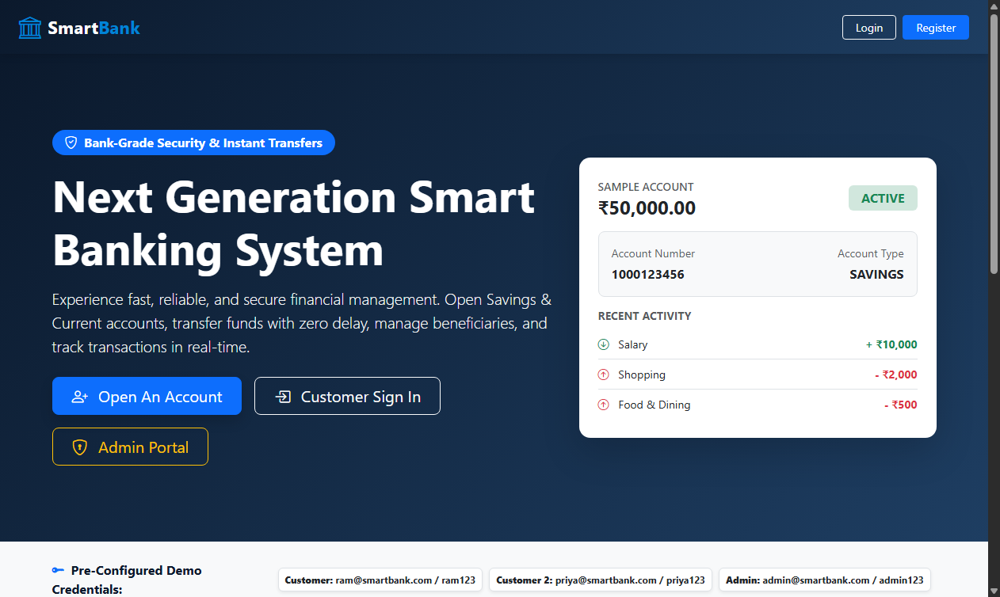
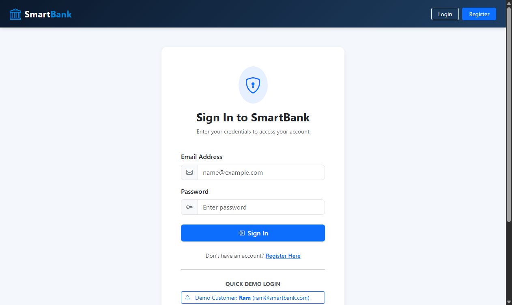
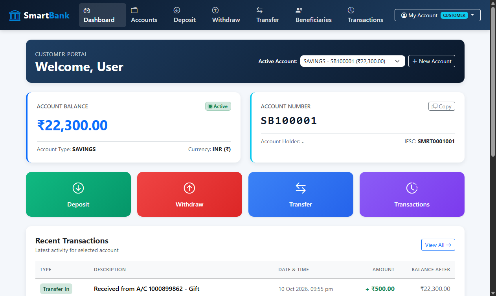
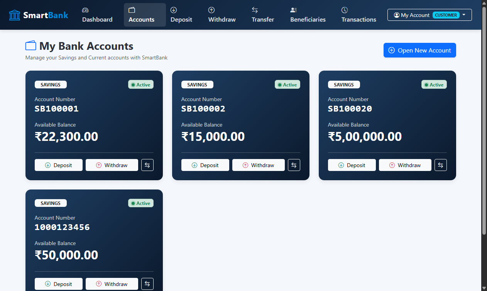
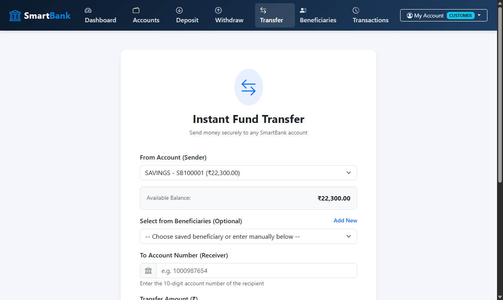
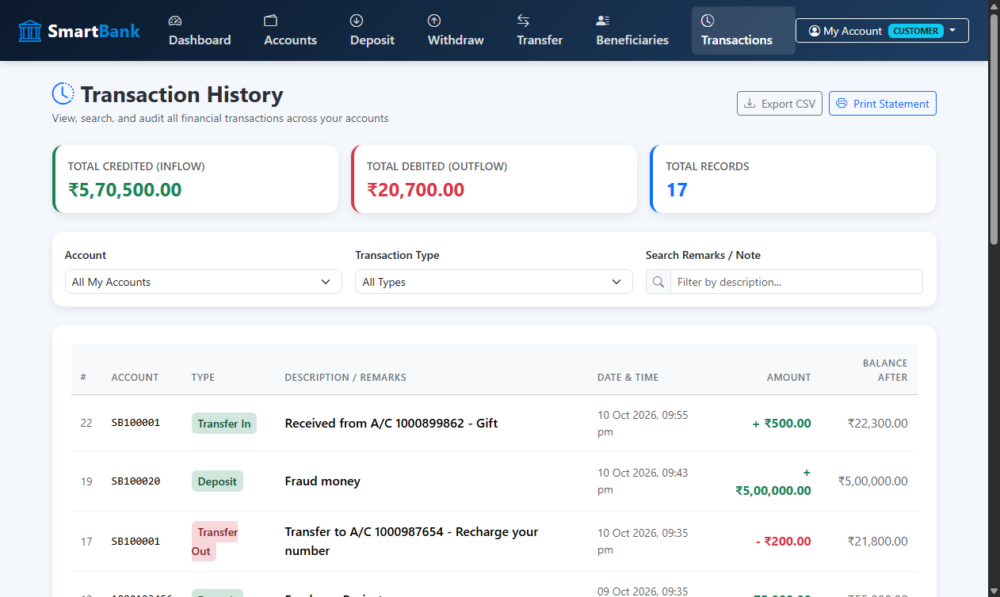
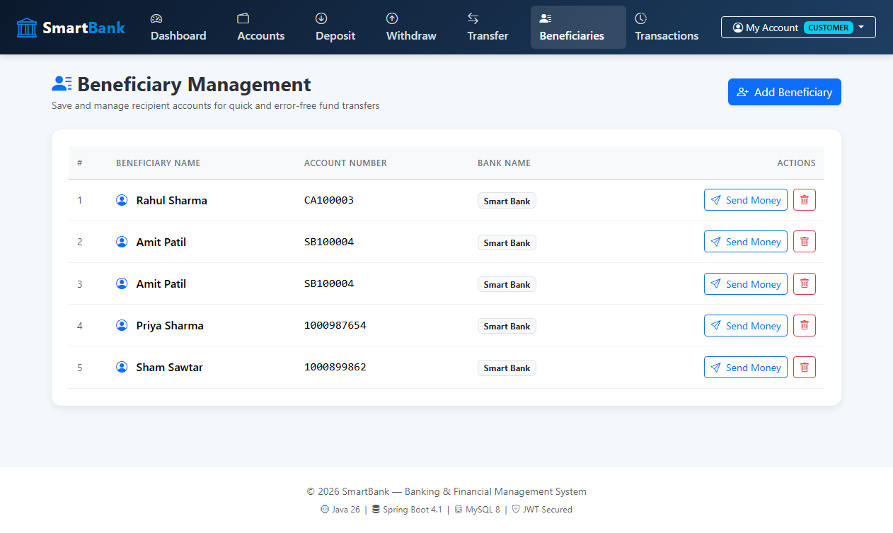
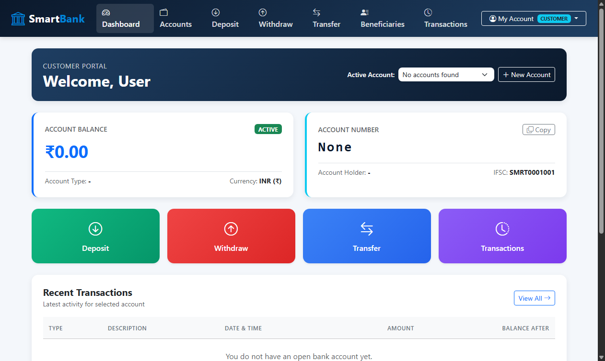

# 🏦 Smart Banking & Financial Management System


A full-stack Smart Banking & Financial Management System built with **Java Spring Boot** backend and a responsive **Bootstrap** frontend. Supports customer accounts, deposits, withdrawals, fund transfers, beneficiary management, and a secure admin portal.

---

## 📋 Table of Contents

- [Features](#-features)
- [Technology Stack](#-technology-stack)
- [Architecture](#-architecture)
- [Database Design](#-database-design)
- [REST API Reference](#-rest-api-reference)
- [Getting Started](#-getting-started)
- [Demo Credentials](#-demo-credentials)
- [Project Structure](#-project-structure)
- [Key Banking Logic](#-key-banking-logic)
- [Security](#-security)
- [Screenshots](#-screenshots)
- [Resume Description](#-resume-description)
- [Interview / Viva Questions](#-interview--viva-questions)

---

## ✨ Features

### 👤 Customer Module
- Register & login with JWT-secured sessions
- View & update profile (name, phone)
- Change password with BCrypt verification
- Role-based access (CUSTOMER / ADMIN)

### 💰 Account Module
- Open Savings or Current accounts
- Auto-generated 10-digit account numbers
- Check balance and account status
- Support for multiple accounts per customer

### 💸 Transaction Module
- Deposit money
- Withdraw with insufficient-funds validation
- Atomic fund transfer between accounts (`@Transactional`)
- Full transaction history with filter & CSV export

### 👥 Beneficiary Module
- Add / delete saved beneficiaries
- Duplicate beneficiary detection
- One-click transfer to saved beneficiaries

### 👨‍💼 Admin Module
- View all customers and accounts
- Block / unblock customer accounts
- View all transactions bank-wide
- Dashboard with key statistics (total balance, deposits, withdrawals, etc.)

---

## 🛠 Technology Stack

| Layer        | Technology                  |
|--------------|-----------------------------|
| Frontend     | HTML5, CSS3, JavaScript (ES6+), Bootstrap 5.3 |
| Backend      | Java 26, Spring Boot 4.1.1  |
| API Style    | REST API (JSON)             |
| ORM          | Hibernate / Spring Data JPA |
| Database     | MySQL 8.0                   |
| Security     | Spring Security + JWT (JJWT 0.12.6) + BCrypt |
| Build Tool   | Maven (mvnw wrapper)        |
| Testing      | Postman                     |

---

## 🏗 Architecture

```
Frontend (HTML/CSS/JS)
       │
       │  fetch() → REST API
       ▼
REST Controller Layer
       │
       ▼
Service Layer (Business Logic)
       │
       ▼
Repository Layer (Spring Data JPA)
       │
       ▼
MySQL Database
```

### Package Structure

```
com.smartbank/
├── SmartBankApplication.java
├── config/
│   ├── CustomUserDetails.java
│   ├── CustomUserDetailsService.java
│   ├── DataInitializer.java         ← Idempotent seed data
│   ├── JwtAuthenticationFilter.java
│   ├── JwtService.java
│   └── SecurityConfig.java
├── controller/
│   ├── AccountController.java
│   ├── AdminController.java
│   ├── AuthController.java
│   ├── BeneficiaryController.java
│   ├── TransactionController.java
│   └── UserController.java
├── dto/                             ← Request/Response DTOs
├── entity/                          ← JPA Entities
├── exception/                       ← Custom exceptions + GlobalExceptionHandler
├── mapper/                          ← Entity → DTO converters
├── repository/                      ← Spring Data JPA interfaces
└── service/                         ← Business logic layer
```

---

## 🗄 Database Design

### ER Diagram

```
users (1) ──────────── (N) accounts (1) ──────────── (N) transactions
  │
  └──── (N) beneficiaries
```

### Table Definitions

**users**
```sql
CREATE TABLE users (
    id         BIGINT PRIMARY KEY AUTO_INCREMENT,
    name       VARCHAR(100)  NOT NULL,
    email      VARCHAR(100)  UNIQUE NOT NULL,
    phone      VARCHAR(15)   UNIQUE NOT NULL,
    password   VARCHAR(255)  NOT NULL,
    role       VARCHAR(20)   DEFAULT 'CUSTOMER',
    status     VARCHAR(20)   DEFAULT 'ACTIVE',
    created_at TIMESTAMP     DEFAULT CURRENT_TIMESTAMP
);
```

**accounts**
```sql
CREATE TABLE accounts (
    id             BIGINT PRIMARY KEY AUTO_INCREMENT,
    account_number VARCHAR(20)    UNIQUE NOT NULL,
    account_type   VARCHAR(20)    NOT NULL,
    balance        DECIMAL(15,2)  DEFAULT 0.00,
    status         VARCHAR(20)    DEFAULT 'ACTIVE',
    user_id        BIGINT         NOT NULL,
    FOREIGN KEY (user_id) REFERENCES users(id)
);
```

**transactions**
```sql
CREATE TABLE transactions (
    id               BIGINT PRIMARY KEY AUTO_INCREMENT,
    transaction_type VARCHAR(20)    NOT NULL,
    amount           DECIMAL(15,2)  NOT NULL,
    balance_after    DECIMAL(15,2)  NOT NULL,
    description      VARCHAR(255),
    transaction_date TIMESTAMP      DEFAULT CURRENT_TIMESTAMP,
    account_id       BIGINT         NOT NULL,
    FOREIGN KEY (account_id) REFERENCES accounts(id)
);
```

**beneficiaries**
```sql
CREATE TABLE beneficiaries (
    id             BIGINT PRIMARY KEY AUTO_INCREMENT,
    name           VARCHAR(100) NOT NULL,
    account_number VARCHAR(20)  NOT NULL,
    bank_name      VARCHAR(100),
    user_id        BIGINT       NOT NULL,
    FOREIGN KEY (user_id) REFERENCES users(id)
);
```

---

## 🌐 REST API Reference

### Authentication
| Method | Endpoint           | Description              |
|--------|--------------------|--------------------------|
| POST   | `/api/auth/register` | Register new customer   |
| POST   | `/api/auth/login`    | Login → returns JWT token |

### Users
| Method | Endpoint                | Auth     | Description          |
|--------|-------------------------|----------|----------------------|
| GET    | `/api/users/me`         | Customer | Get own profile      |
| PUT    | `/api/users/me`         | Customer | Update name/phone    |
| PUT    | `/api/users/change-password` | Customer | Change password |

### Accounts
| Method | Endpoint                   | Auth     | Description              |
|--------|----------------------------|----------|--------------------------|
| POST   | `/api/accounts`            | Customer | Open new account         |
| GET    | `/api/accounts/my`         | Customer | Get own accounts         |
| GET    | `/api/accounts/my/{id}`    | Customer | Get specific account     |
| POST   | `/api/accounts/{id}/deposit`  | Customer | Deposit money         |
| POST   | `/api/accounts/{id}/withdraw` | Customer | Withdraw money        |
| POST   | `/api/accounts/{id}/transfer` | Customer | Transfer to another   |

### Transactions
| Method | Endpoint                          | Auth     | Description                |
|--------|-----------------------------------|----------|----------------------------|
| GET    | `/api/transactions/my`            | Customer | All my transactions        |
| GET    | `/api/transactions/my/recent`     | Customer | Recent 10 transactions     |
| GET    | `/api/transactions/account/{id}`  | Customer | Transactions by account    |

### Beneficiaries
| Method | Endpoint                        | Auth     | Description              |
|--------|---------------------------------|----------|--------------------------|
| GET    | `/api/beneficiaries/my`         | Customer | Get saved beneficiaries  |
| POST   | `/api/beneficiaries`            | Customer | Add beneficiary          |
| DELETE | `/api/beneficiaries/{id}`       | Customer | Remove beneficiary       |

### Admin
| Method | Endpoint                           | Auth  | Description              |
|--------|------------------------------------|-------|--------------------------|
| GET    | `/api/admin/dashboard`             | Admin | Bank-wide stats          |
| GET    | `/api/admin/customers`             | Admin | All customers            |
| GET    | `/api/admin/accounts`              | Admin | All accounts             |
| PUT    | `/api/admin/accounts/{id}/block`   | Admin | Block account            |
| PUT    | `/api/admin/accounts/{id}/unblock` | Admin | Unblock account          |
| GET    | `/api/admin/transactions`          | Admin | All transactions         |

---

## 🚀 Getting Started

### Prerequisites

- **Java 21+** (tested on Java 26)
- **MySQL 8.0** running on `localhost:3306`
- **Maven** (or use included `mvnw` wrapper)

### 1. Clone the Repository

```bash
git clone https://github.com/your-username/smart-bank.git
cd smart-bank/smart-bank
```

### 2. Configure Database

Create the database (auto-created if it doesn't exist):

```sql
CREATE DATABASE IF NOT EXISTS smart_bank_db;
```

Update `src/main/resources/application.properties` if needed:

```properties
spring.datasource.url=jdbc:mysql://localhost:3306/smart_bank_db?createDatabaseIfNotExist=true&useSSL=false&serverTimezone=UTC&allowPublicKeyRetrieval=true
spring.datasource.username=root
spring.datasource.password=your_password
```

### 3. Build & Run

```bash
# Windows
.\mvnw.cmd package -DskipTests
java -jar .\target\smart-bank-0.0.1-SNAPSHOT.jar

# Mac/Linux
./mvnw package -DskipTests
java -jar target/smart-bank-0.0.1-SNAPSHOT.jar
```

### 4. Open in Browser

```
http://localhost:8080
```

The application automatically:
- Creates all database tables via Hibernate DDL
- Seeds demo users, accounts, and sample transactions

---

## 🔑 Demo Credentials

| Role     | Email                   | Password  |
|----------|-------------------------|-----------|
| Customer | ram@smartbank.com       | ram123    |
| Customer | priya@smartbank.com     | priya123  |
| Admin    | admin@smartbank.com     | admin123  |

---

## 📁 Project Structure

```
smart-bank/
├── src/
│   ├── main/
│   │   ├── java/com/smartbank/
│   │   │   ├── SmartBankApplication.java
│   │   │   ├── config/          ← Security, JWT, DataInitializer
│   │   │   ├── controller/      ← REST endpoints
│   │   │   ├── dto/             ← Request / Response objects
│   │   │   ├── entity/          ← JPA entities (User, Account, etc.)
│   │   │   ├── exception/       ← Custom exceptions + global handler
│   │   │   ├── mapper/          ← Entity ↔ DTO converters
│   │   │   ├── repository/      ← Spring Data JPA repos
│   │   │   └── service/         ← Business logic
│   │   └── resources/
│   │       ├── application.properties
│   │       └── static/          ← Frontend (HTML/CSS/JS)
│   │           ├── index.html
│   │           ├── login.html
│   │           ├── register.html
│   │           ├── dashboard.html
│   │           ├── accounts.html
│   │           ├── deposit.html
│   │           ├── withdraw.html
│   │           ├── transfer.html
│   │           ├── transactions.html
│   │           ├── beneficiaries.html
│   │           ├── profile.html
│   │           ├── admin-dashboard.html
│   │           ├── users.html
│   │           ├── css/style.css
│   │           └── js/app.js
├── screenshots/                     ← Application screenshots
├── pom.xml
└── README.md
```

---

## 💡 Key Banking Logic

### Deposit
```
Old Balance = ₹10,000
Deposit     = ₹5,000
──────────────────────
New Balance = ₹15,000
```
Records a `DEPOSIT` transaction and updates account balance.

### Withdraw
```
Balance  = ₹10,000
Withdraw = ₹3,000
──────────────────────
New Balance = ₹7,000

BUT if Withdraw > Balance → throws InsufficientFundsException (HTTP 400)
```

### Transfer (Atomic with @Transactional)
```
Account A → Account B
Amount = ₹5,000

A.balance = A.balance - 5000   (TRANSFER_OUT recorded)
B.balance = B.balance + 5000   (TRANSFER_IN recorded)

Both succeed or both are rolled back together.
```

---

## 🔐 Security

- **BCrypt** password hashing (strength 10) — plain-text passwords are never stored
- **JWT** stateless authentication with 24-hour expiry (HMAC-SHA512)
- **Spring Security** filter chain validates every request
- **Role-based access**: `CUSTOMER` and `ADMIN` roles with separate protected route groups
- **`@Transactional`** ensures atomicity of deposit / withdraw / transfer operations
- Blocked accounts return HTTP 400 — cannot perform any transaction

---

## 📸 Screenshots

### 1. Landing Page
Clean, modern landing page displaying feature highlights, architecture stack, and quick demo credentials.


---

### 2. Authentication & Sign In
JWT-secured login supporting fast one-click demo credentials filling for Customers and Administrators.


---

### 3. Customer Dashboard
Real-time customer dashboard showing current balance, active account selector, quick banking actions, recent transaction statement, and saved beneficiaries.


---

### 4. Multi-Account Management
Support for opening multiple Savings and Current accounts, with real-time balance cards and status indicators.


---

### 5. Fund Transfer
Atomic money transfer with account selection, payee beneficiary dropdown, instant balance validation, and `@Transactional` guarantee.


---

### 6. Transaction Statement & CSV Export
Comprehensive audit log of all deposits, withdrawals, and transfers with real-time search, transaction type filters, and one-click CSV export.


---

### 7. Beneficiaries Directory
Saved payees list for frequently accessed accounts with one-click direct transfer and instant beneficiary removal.


---

### 8. Executive Admin Dashboard
High-level bank administration portal displaying total customers, system liquidity, transaction volume, and account access controls (Block / Unblock accounts).


---

### 9. Admin Customer Directory
Searchable customer directory for bank staff with contact details, role indicators, and account active/blocked status.


---

## 📄 Resume Description

> **Smart Banking & Financial Management System**  
> *Java, Spring Boot 4.1, MySQL 8, Hibernate JPA, Spring Security, JWT, Bootstrap 5*
>
> Built a full-stack banking web application with RESTful APIs, JWT-secured authentication, and role-based authorization (Customer/Admin). Implemented atomic fund transfers using `@Transactional`, BCrypt password hashing, layered architecture (Controller → Service → Repository), and a responsive Bootstrap frontend that communicates with the backend via JavaScript `fetch()`. Features include multi-account management, transaction history with CSV export, beneficiary management, and an admin portal for monitoring and account control.

---

## 🎓 Interview / Viva Questions

### Spring Boot & Architecture
1. What is Spring Boot and how does it differ from plain Spring?
2. What is the difference between `@RestController` and `@Controller`?
3. Explain the layered architecture used in this project (Controller → Service → Repository).
4. What is `@Transactional` and why is it critical for money transfers?
5. What does `spring.jpa.hibernate.ddl-auto=update` do?

### JPA / Hibernate
6. What is the difference between `@OneToMany` and `@ManyToOne`?
7. Explain `FetchType.LAZY` vs `FetchType.EAGER`.
8. What is the N+1 query problem and how do you avoid it?
9. What does `@PrePersist` do in the Transaction entity?

### Security & JWT
10. How does JWT authentication work?
11. What is the difference between Authentication and Authorization?
12. Why do we use BCrypt instead of MD5 or SHA-1 for password hashing?
13. What is a stateless session and why does JWT enable it?
14. How does `OncePerRequestFilter` work in the JWT filter?

### REST API
15. What HTTP status codes does this project return and when?
16. What is the difference between PUT and PATCH?
17. How are validation errors handled globally using `@RestControllerAdvice`?
18. What is a DTO (Data Transfer Object) and why is it better to use it instead of exposing entities directly?

### Database
19. What is a foreign key? Give an example from this project.
20. Why is `DECIMAL(15,2)` used for balance instead of `FLOAT` or `DOUBLE`?
21. What is a database transaction and how does it relate to ACID properties?
22. What does `createDatabaseIfNotExist=true` do in the JDBC URL?

### Frontend Integration
23. How does the frontend authenticate API requests?
24. What is CORS and why might it be an issue in this project?
25. How does `localStorage` store and retrieve JWT tokens?
